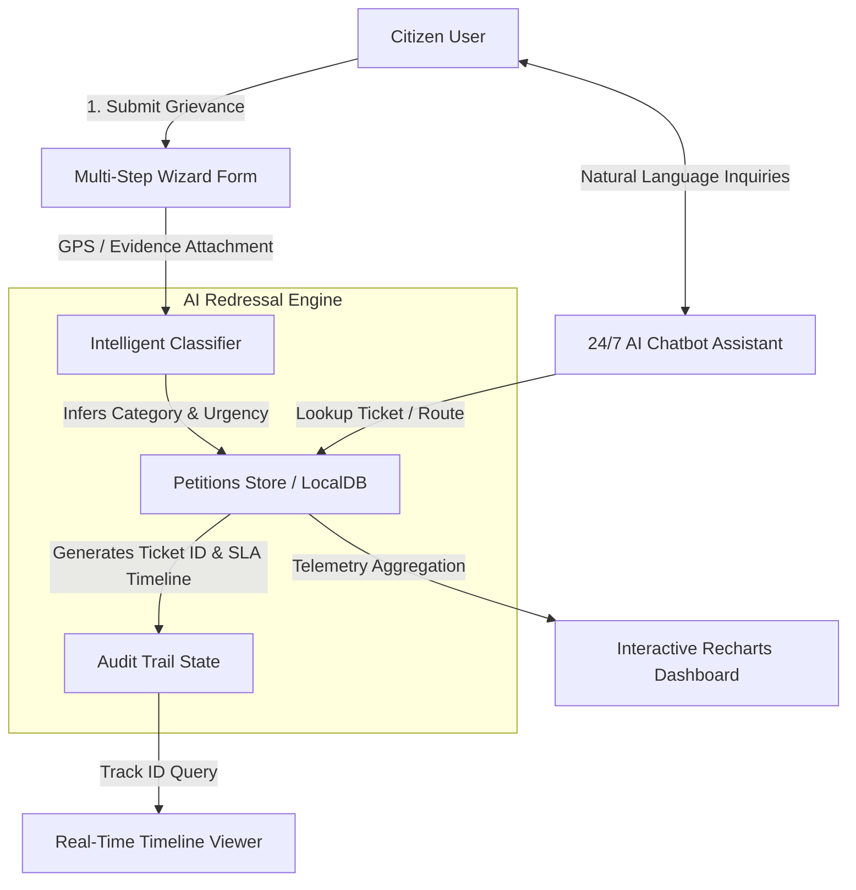

# 🏛️ CitizenVoice — AI-Powered Citizen Grievance Redressal Portal

[](https://github.com/your-username/citizenvoice-ai-grievance-portal/actions)


> **CitizenVoice** is a modern, full-lifecycle civic grievance redressal and petition tracking platform. It leverages automated AI classification, priority routing, SLA milestone tracking, and analytical telemetry to bridge the gap between citizens and municipal authorities.

---

## 📌 Problem Statement

In conventional municipal governance:
1. **Opaque Resolution**: Citizens submit complaints without visibility into departmental assignment, timeline SLAs, or active progress.
2. **Manual Misclassification**: Backlog accumulates because petitions are manually sorted across disjointed civic departments (Public Works, Water Board, Transport, Health).
3. **Lack of Telemetry**: Civic leaders lack real-time resolution metrics and early warning indicators for escalating complaints.

**CitizenVoice** solves this by providing:
- **Guided 3-Step Multi-Modal Filing**: Auto-geocoding, photo/document evidence attachment, and intelligent category/urgency inference.
- **Transparent Audit Trail**: Public milestone tracker with real-time status updates and target resolution SLAs.
- **Civic Analytics Dashboard**: Workload distribution, historical resolution velocity, and departmental compliance telemetry.
- **24/7 AI Companion**: Context-aware virtual assistant for lodging complaints, checking ticket status, and answering civic questions.

---

## 🏗️ System Architecture & Data Flow



---

## ✨ Key Feature Highlights

### 1. 📝 Guided Grievance Submission
- **Multi-Step Wizard**: Form validation across Basic Info, Details & Evidence, and AI Review stages.
- **Evidence Dropzone**: Multi-file attachment with support for photos, PDFs, and invoices.
- **Location Geolocation**: Integrated GPS coordinate grabber with fallback support.
- **Auto-Categorization**: Natural-language heuristic categorization and urgency tagging (Low, Medium, High).

### 2. 🔍 Real-Time Petition Tracking
- Instant lookup by unique Petition ID (e.g., `PET-2024-001234`).
- Visual phase timeline with color-coded nodes for Completed, In-Flight, and Pending stages.
- Department assignment, estimated SLA resolution dates, and deep links from dashboard.

### 3. 📊 Civic Analytics & SLA Dashboard
- **Telemetry Cards**: Real-time totals for Total, In Progress, Resolved, and Escalated cases.
- **Inflow vs. Resolution Trend**: Area chart tracking 6-month resolution velocity built with Recharts.
- **Departmental Workload & SLA Adherence**: Multi-bar comparative chart illustrating civic case loads.
- **Live Search & Filter**: Instant filtering across status tabs and keyword search.

### 4. 🤖 24/7 AI Chatbot Companion
- Floating widget accessible anywhere across the portal.
- Handles natural-language queries, suggests quick prompts, detects ticket numbers, and provides direct navigational shortcuts.
- Simulated voice input dictation helper.

### 5. 🔐 Citizen Access & Demo Authentication
- Tabbed Sign In / Sign Up portal with credentials verification.
- **1-Click Instant Demo Login** for rapid evaluation during recruiter demos and interviews.

---

## 🛠️ Tech Stack & Libraries

| Layer | Technology | Purpose |
| :--- | :--- | :--- |
| **Framework** | [React 18](https://react.dev/) + [Vite 5](https://vitejs.dev/) | High-performance SPA compilation & HMR |
| **Language** | [TypeScript](https://www.typescriptlang.org/) | Strict static type checking and domain models |
| **Styling** | [Tailwind CSS](https://tailwindcss.com/) + CSS Variables | HSL design tokens, responsive typography & dark mode |
| **Component Library** | [shadcn/ui](https://ui.shadcn.com/) (Radix UI) | Accessible, unstyled primitives with high UX fidelity |
| **Data Visualization** | [Recharts](https://recharts.org/) | Responsive SVG charts (AreaChart, BarChart) |
| **Icons** | [Lucide React](https://lucide.dev/) | Consistent iconography |
| **Routing** | [React Router v6](https://reactrouter.com/) | Client-side routing with URL query state persistence |
| **CI / CD** | GitHub Actions | Automated type-check and production build validation |

---

## 🚀 Getting Started Locally

### Prerequisites
- [Node.js](https://nodejs.org/) (v18.0.0 or higher recommended)
- `npm` or `yarn`

### Installation

1. **Clone the repository**:
   ```bash
   git clone https://github.com/your-username/citizenvoice-ai-grievance-portal.git
   cd citizenvoice-ai-grievance-portal
   ```

2. **Install dependencies**:
   ```bash
   npm install
   ```

3. **Start the development server**:
   ```bash
   npm run dev
   ```
   Open your browser at `http://localhost:8080/`.

4. **Run static type checking**:
   ```bash
   npx tsc --noEmit
   ```

5. **Build for production**:
   ```bash
   npm run build
   ```

---

## 📂 Project Structure

```
├── .github/
│   └── workflows/
│       └── ci.yml             # Automated CI pipeline (typecheck & build)
├── public/                    # Static public assets
├── src/
│   ├── assets/                # Images & illustrations
│   ├── components/            # Shared UI components
│   │   ├── ui/                # shadcn/ui primitives (Radix)
│   │   ├── ChatbotWidget.tsx  # Floating 24/7 AI assistant
│   │   ├── Navbar.tsx         # Responsive navigation bar
│   │   └── StatusBadge.tsx    # Color-coded petition status badge
│   ├── lib/
│   │   ├── petitions.ts       # Domain models, initial mock data, storage helpers
│   │   └── utils.ts           # Class merge utilities (clsx & tailwind-merge)
│   ├── pages/
│   │   ├── Index.tsx          # Landing page with hero & metrics
│   │   ├── SubmitGrievance.tsx# 3-step filing wizard
│   │   ├── TrackPetition.tsx  # Status search & timeline audit trail
│   │   ├── Dashboard.tsx      # Analytics & petitions management hub
│   │   ├── Auth.tsx           # Citizen sign in & demo credentials
│   │   └── NotFound.tsx       # 404 handler
│   ├── App.tsx                # App routes & providers
│   ├── index.css              # Custom HSL design tokens & Tailwind directives
│   └── main.tsx               # Application entry point
├── package.json               # Dependencies and scripts
├── tsconfig.json              # TypeScript configuration
└── vite.config.ts             # Vite build configuration
```

---

## 📄 License

This project is licensed under the [MIT License](LICENSE).
